# Sơ đồ UML Lớp – Template Method Xử lý thanh toán

Thư mục này chứa định nghĩa và sơ đồ UML lớp cho dự án `PaymentTemplateMethod`.

## 1. Tệp nguồn sơ đồ
- `PaymentTemplateMethod_UML.puml`: File mã nguồn PlantUML chuẩn để mở hoặc sinh ảnh trực tiếp. Có thể mở bằng JetUML, VS Code PlantUML extension hoặc nhập trực tiếp vào [PlantText](https://www.planttext.com/) / [draw.io](https://app.diagrams.net/).

## 2. Biểu diễn Mermaid (Xem trực tiếp trên Markdown / GitHub / IDE)

```mermaid
classDiagram
    direction TB

    class PaymentProcessor {
        <<abstract>>
        -List~String~ aLog
        +process(Order pOrder) PaymentResult$
        #validateOrder(Order pOrder) void
        #issueReceipt(Order pOrder, long pFee) void
        #calculateFee(Order pOrder)* long
        #authenticate(Order pOrder)* void
        #charge(Order pOrder, long pFee)* void
        #requiresAuthentication() boolean
        #notifyCustomer(Order pOrder) void
        #log(String pMessage) void
        +getLog() List~String~
        #money(long pAmount)$ String
    }

    class CreditCardPayment {
        +String VALID_OTP$
        -String aCardNumber
        -String aEnteredOtp
        -long aRemainingLimit
        +CreditCardPayment(String pCardNumber, long pCreditLimit, String pEnteredOtp)
        #calculateFee(Order pOrder) long
        #authenticate(Order pOrder) void
        #charge(Order pOrder, long pFee) void
    }

    class EWalletPayment {
        +String VALID_PIN$
        -long MIN_FEE$
        -String aPhoneNumber
        -String aEnteredPin
        -long aBalance
        +EWalletPayment(String pPhoneNumber, long pBalance, String pEnteredPin)
        #calculateFee(Order pOrder) long
        #authenticate(Order pOrder) void
        #charge(Order pOrder, long pFee) void
        #notifyCustomer(Order pOrder) void
    }

    class BankTransferPayment {
        -long FLAT_FEE$
        -String aReceivingAccount
        +BankTransferPayment(String pReceivingAccount)
        #calculateFee(Order pOrder) long
        #requiresAuthentication() boolean
        #authenticate(Order pOrder) void
        #charge(Order pOrder, long pFee) void
        #notifyCustomer(Order pOrder) void
    }

    class Order {
        -String aOrderId
        -String aCustomerName
        -long aAmount
        -boolean aPaid
        +Order(String pOrderId, String pCustomerName, long pAmount)
        +getOrderId() String
        +getCustomerName() String
        +getAmount() long
        +isPaid() boolean
        +markPaid() void
    }

    class PaymentResult {
        <<final>>
        -boolean aSuccess
        -long aFee
        -String aMessage
        +success(long pFee, String pMessage)$ PaymentResult
        +failure(String pMessage)$ PaymentResult
        +isSuccess() boolean
        +getFee() long
        +getMessage() String
        +toString() String
    }

    class PaymentException {
        +PaymentException(String pMessage)
    }

    PaymentProcessor <|-- CreditCardPayment : extends
    PaymentProcessor <|-- EWalletPayment : extends
    PaymentProcessor <|-- BankTransferPayment : extends

    PaymentProcessor ..> Order : uses
    PaymentProcessor ..> PaymentResult : returns
    PaymentProcessor ..> PaymentException : throws
```

## 3. Phân loại các phương thức trong `PaymentProcessor`
- **Template Method**: `process(Order)` được khai báo `final` nhằm khóa chặt khung xương thuật toán (6 bước), ngăn không cho các lớp con thay đổi thứ tự thực hiện.
- **Các bước chung (Concrete Methods)**:
  - `validateOrder(Order)`: Kiểm tra hợp lệ đơn hàng, ném `PaymentException` nếu sai hoặc đơn đã thanh toán.
  - `issueReceipt(Order, long)`: In biên lai đồng bộ cho mọi phương thức thanh toán.
- **Các bước trừu tượng (Abstract Methods - Primitive Operations)**:
  - `calculateFee(Order)`: Mỗi phương thức có cách tính phí riêng (2%, 1% tối thiểu 1.000đ, hoặc cố định 5.000đ).
  - `authenticate(Order)`: Xác thực người dùng (OTP, PIN...).
  - `charge(Order, long)`: Khấu trừ tiền giao dịch (hạn mức thẻ, số dư ví, mã chuyển khoản).
- **Các phương thức Hook (Hooks)**:
  - `requiresAuthentication()`: Mặc định trả về `true`. Lớp `BankTransferPayment` ghi đè trả về `false` để bỏ qua bước xác thực.
  - `notifyCustomer(Order)`: Mặc định gửi email xác nhận. Lớp `EWalletPayment` ghi đè để gửi tin nhắn trong ứng dụng ví; lớp `BankTransferPayment` ghi đè để gửi email kèm số tài khoản.

